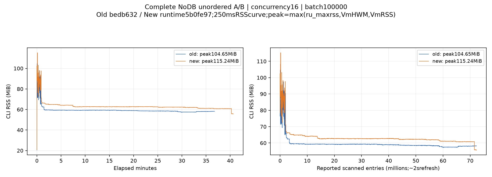

# DB 重构 A/B 性能记录

**状态：2026-11-06 22:41:58（UTC+8）按用户要求暂停。** 已停止本次控制器和实际 CLI，确认没有本次扫描进程继续运行。性能验收未完成，以下实测没有替代 [PR #135／#137 历史基准](scan-performance-baseline.md)。

## 环境与产物

主机 `10.131.5.223`，32 核、385074 MiB 内存；源为整个 `nfs://10.131.5.221/m1-source`。
两版共用独立 loader／运行库，真实 CLI、无额外 callback，依次执行。

| 版本 | 运行时代码 | 二进制 SHA-256 |
| --- | --- | --- |
| 重构前 | bedb63239b26f4ceea383edd94aff78135ad0780 | 09b4154c4b5c21cd028136628a13ded9e3898daa5fd424905a7c18589e95c6a6 |
| 重构后 | 5b0fe97e67ef07704feb5d9b98e2bff76c302384 | 9f0c14a70d76ac98aa3c9634cca40cd78e851dc9b243dc491cd2cfcaa3b4f39f |

完整轮次均为 **72,365,234 条目**：67,877,224 普通文件、4,488,010 目录、0 软链接，普通文件字节数 **2,193,608,995,900**，错误为零。
原始数据保持不变；本次独立源夹具含 1,100,000 空文件，暂停时保留以便后续使用，尚未进行大数据集的受控增删改。

## 16 并发／100,000 批次：全量无 DB

| 轮次 | 版本 | 完整耗时（秒） | 普通文件/秒 | 条目/秒 | 观测峰值 RSS |
| --- | --- | ---: | ---: | ---: | ---: |
| 首轮 | 重构前 | 2206.438 | 30,763.3 | 32,797.3 | 104.648 MiB |
| 首轮 | 重构后 | 2438.617 | 27,834.3 | 29,674.7 | 115.238 MiB |
| 重复轮 | 重构前 | 1785.707 | 38,011.4 | 40,524.7 | 116.484 MiB |
| 重复轮 | 重构后 | 用户暂停，未完成 | — | — | 不作整轮结论 |

首轮新版耗时增加 **10.52%**，吞吐下降 **9.52%**。同一个旧版重复耗时下降 **19.07%**，显示显著运行波动；尚未确定缓存、NAS／网络状态和遍历时序各自的影响，未确认固定的代码回退根因。
首轮旧／新累计 CPU 时间为 485.67／496.53 秒，耗时差约 232 秒而 CPU 差约 11 秒；仅据此不能定位具体等待点。
源码核对确认两版显式 NFS 连接配置、扫描并发传递一致，`nfs-rs` 均为同一 checksum 的 0.11.1；日志没有恢复警告，进度曲线没有大幅回退。

峰值取 GNU time 的 ru_maxrss、已采样 VmHWM 和 VmRSS 中较大者，保留两种内核报告的差异。
首轮前／后段 p90：旧版 59.320／58.566 MiB，新版 62.734／62.324 MiB；重复旧版 63.602／60.703 MiB。
这几轮未显示持续上升趋势，不能证明任意规模无泄漏。

重复新版最后一次周期观测为 **900.735 秒、49,160,536 条目、RSS 65.746 MiB**，不是完整扫描结果。
暂停后 GNU time 保存的分段 ru_maxrss 为 127560 KiB，退出码 101；控制器终止及 PTY 断开后没有完整结束摘要，具体退出原因未定位，不归入业务失败或性能结论。
该中断轮的 250ms 内存缓冲尚未写盘，保留了 CLI 日志、GNU time 资源值及稀疏环境采样；完整轮次的连续曲线均已保存。

## 8 并发／8,192 批次：早期诊断

该配置在用户明确历史参数后停止，保留 7 次完整执行，作为诊断数据。

| 场景 | 版本 | 完整耗时（秒） | 普通文件/秒 | 条目/秒 | 采样峰值 RSS |
| --- | --- | ---: | ---: | ---: | ---: |
| NoDB unordered | 前 | 1342.481 | 50,561.0 | 53,904.1 | 87.422 MiB |
| NoDB unordered | 后 | 1345.469 | 50,448.8 | 53,784.4 | 93.898 MiB |
| NoDB blocks | 前 | 1354.989 | 50,094.3 | 53,406.5 | 101.547 MiB |
| NoDB blocks | 后 | 1359.733 | 49,919.5 | 53,220.2 | 108.965 MiB |
| 集群全量 | 前 | 1604.829 | 42,295.6 | 45,092.2 | 136.234 MiB |
| 集群全量 | 后 | 1702.985 | 39,857.8 | 42,493.2 | 134.059 MiB |
| 集群无变更增量 | 后 | 2141.522 | 31,695.8 | 33,791.5 | 278.230 MiB |

全量两版数据库事实、路径校验和、统计一致；新版无变化增量的新增／修改／删除／重命名均为零。
该配置下新版全量比旧版耗时增加 6.12%，相对自身无 DB 吞吐损失约 21%，不作性能通过结论。
内存为 250ms VmRSS 采样，方法与后来的 ru_maxrss／VmHWM 组合不同。
尚未结束的旧版增量与两个触及开发机 NAS 挂载点的文件检索重叠；检索已停止，该轮不采用为无干扰性能比较。

## 证据与待办

汇总：[JSON](evidence/2026-11-06-db-refactor-ab.json)、[CSV](evidence/2026-11-06-db-refactor-ab.csv)。JSON 同时保存原始报告路径与 SHA-256。
完整日志、曲线采样、各阶段资源值、环境快照和驱动副本位于 `/work/terrasync-db-refactor-evidence/remote-223-ab/`：

- `complete-ab-20261106-090800/`：8／8192 诊断，7 次完整执行。
- `complete-ab-20261106-123937/`：16／100000 首轮 NoDB 完整 A/B。
- `complete-ab-20261106-135702/`：重复旧版完整、新版中断及用户暂停记录。
- `history-reference/`：PR #135／#137／#138 和历史提交文档快照。

16／100000 下集群全量、实际断点全量、0／约 1% 增量及实际断点增量的完整性能矩阵尚未完成。
小目录 22 次功能预演通过不等于上述性能验收完成；性能继续暂停，后续结果以历史基准及同口径真实复测评价。
